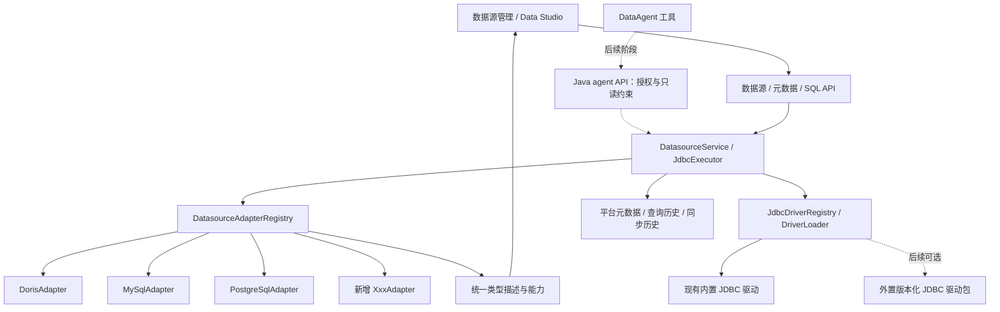

# 数据源适配器架构设计

日期：2026-10-22。状态：**阶段一、二已实施（2026-10-25）**。本轮不实施阶段三、四；既有 PostgreSQL 变更另见[原设计](2026-10-22-postgresql-datasource-design.md)。

## 1. 目标与边界

目标是：新增一个 JDBC 数据库的基础支持，只需新增适配器实现、驱动描述与契约/真实数据库测试；Doris/MySQL/PostgreSQL 默认使用内置驱动，外置驱动仅作为新增 JDBC 数据库或覆盖内置版本的可选扩展。不修改通用连接服务、元数据同步流程、前端类型列表或共享 agent runtime。适配器可以带自己的 SQL 和私有辅助文件，“只加适配器”不等于所有数据库都严格只加一个源文件。

基础支持指：配置与测试连接、目录/表/视图、表结构、基本信息、统计（按引擎可用性）、数据预览和 SQL 执行。完整 DDL、物理结构编辑、备份和智能查询各自声明可选能力，不因连通成功自动开放。

第一阶段迁移 Doris、MySQL、PostgreSQL 验证机制，不顺带新增一批数据库。MongoDB、Redis、Elasticsearch 等非关系查询模型不硬塞 JDBC 表结构契约；确有业务需求时另设连接器接口。

## 2. 当前问题与受影响栈

| 层 | 当前实现 | 问题 |
| --- | --- | --- |
| Java 8 / Spring Boot | `DorisClusterService`、`DorisConnectionService` | 类型白名单、URL、字符集、元数据 SQL 和引擎判断散布在业务代码 |
| Java 元数据同步 | `DorisMetadataSyncService` | 消费统一结果，但夹杂 Doris 专属统计和物理属性语义 |
| Java 表编辑 | `TableEngineHandler` / Registry | 已有独立编辑处理器，可复用；类型依赖枚举，不能当成基础接入门槛 |
| Vue 3 / Element Plus | 数据源管理、Data Studio | 类型、端口、数据库必填、标识符引号、默认 SQL 和 UI 分支含硬编码 |
| Java agent API | `AgentJdbcExecutor`、`BackendAgentMetadataService` | 独立拼接 MySQL JDBC/DDL，源类型映射只有 MySQL/Doris |
| Python DataAgent | `core/datasource_resolver.py` | 同样有 MySQL/Doris 二选一映射，新增类型可能被误判 |
| MySQL / 部署 | `doris_cluster`、Flyway、应用 JDBC 依赖 | 配置字段固定，特殊连接参数缺少明确扩展槽；驱动有 Java 版本约束 |

仅抽出一个 JDBC URL 工厂无法达到目标：类型发现、元数据方言、查询页、能力控制和 agent 入口也必须消费同一份描述。

## 3. 整体结构



通用服务保留权限校验、凭据选择、连接生命周期、超时与取消、查询限制、元数据持久化、差异比较和同步历史。适配器只实现数据库差异，不访问平台 mapper，不创建同步历史，不操纵 agent 会话。

### 包与模块拆分

先在现有 `backend` Maven 模块内按包划分职责，不立即增加一组 Maven 子模块。现有 `odw-auth`、`backend-agent-api` 和 Python DataAgent 边界保持。

```text
backend/.../service/datasource/
  model/       连接配置、Namespace、规范化元数据、类型与能力描述
  spi/         Adapter、MetadataReader、SqlDialect、可选能力接口
  core/        适配器注册、连接获取、SQL 执行与取消、能力校验
  driver/      本轮检查内置驱动可用性；预留版本绑定、加载器和生命周期
  adapters/
    mysql/     MySQL 特有连接/元数据/方言
    doris/     Doris 特有元数据、物理信息与方言
    postgresql/

现有 service/ 元数据同步、版本与同步历史：应用编排层
现有 service/table/：可选物理编辑处理器
现有备份 service：可选备份业务
现有 controller/、agentapi/：入口与各自授权契约
```

`model` 仅放数据契约；`spi` 依赖 model/JDBC；core 和 adapters 依赖 spi；driver 管加载和连接驱动实例，不依赖具体适配器。业务编排通过 core 使用能力。Spring 负责组装，core 不 import 具体 adapter 类。前端和 DataAgent 只使用公开 API/描述。

### 适配器与 JDBC 驱动分开

适配器解释 namespace、元数据与 SQL 差异，JDBC 驱动负责通信。Doris/MySQL/PostgreSQL 和平台元数据库继续使用现有 pom 内置依赖。未配置任何驱动目录时行为与当前部署一致，升级无需 driverId 绑定迁移，也不改变平台 Spring/MyBatis/Flyway 启动路径。

本轮取舍：实现适配器声明所需 driverClass、驱动可用/缺失状态及执行前检查。驱动类必须实现 java.sql.Driver；描述不暴露密码。完整外置加载涉及类隔离、部署与版本生命周期，会显著扩大阶段一、二范围，记录到 docs/TODO.md，本轮不提供目录配置或 driverId 选择，不添加无效 schema 字段。

后续可选外置目录使用显式 manifest：driverId、版本、driverClass、兼容类型、JAR 清单、校验和及 Java 要求。driverId 为空继续内置路径；显式绑定外置包时必须检查依赖、Java 8 兼容性和校验和，失败明确报错，不退回内置或最新版本。覆盖内置版本必须显式选择，不按扫描/classpath 顺序决定。

外置模块通过独立、受控 ClassLoader 实例化 Driver 并直接 connect；Java/JDBC API 保持父加载器一致，厂商依赖隔离必须用双版本契约测试证明，不影响平台 MySQL。由部署方管理可执行 JAR，多副本 manifest 一致，首版重启生效。网页上传、Maven 自动下载、在线切换及热加载不在本轮范围。

## 4. 适配器契约

建议代码位置：`backend/src/main/java/com/onedata/portal/service/datasource/`，核心接口按三个职责组合，避免一个接口塞满所有高级功能。

| 契约 | 职责 |
| --- | --- |
| `DatasourceAdapter` | 返回描述、配置校验、连接规格和会话初始化，提供 metadata reader / dialect |
| `DatasourceMetadataReader` | 返回规范化 Namespace/Table/Column/Statistics DTO；读取表、视图、字段、注释、主键、默认值及可用统计 |
| `DatasourceSqlDialect` | 标识符转义、限定名、预览/分页、默认 SELECT、可选 EXPLAIN 的生成 |
| `DatasourceAdapterRegistry` | Spring 收集适配器，规范化字符串 type 后注册，校验重复注册和描述一致性 |
| 可选能力接口 | 完整 DDL reader、既有 `TableEngineHandler` 结构编辑、备份 provider 等 |

示意契约如下，仅用于说明边界：

```java
interface DatasourceAdapter {
    DatasourceDescriptor descriptor();
    void validate(ConnectionConfig config);
    JdbcConnectionSpec connectionSpec(ConnectionConfig config, Namespace namespace);
    void initializeSession(Connection connection, Namespace namespace);
    DatasourceMetadataReader metadata();
    DatasourceSqlDialect dialect();
}
```

`JdbcConnectionSpec` 包含 URL/连接属性及驱动类型约束，本轮由 DriverRegistry 检查内置 driverClass；可选 driverId 解析留在 driver 模块扩展。它不包含响应给前端的密码；通用凭据策略选择配置凭据或已有用户映射，再通过现有内置 JDBC 路径打开连接。适配器不 import 厂商驱动类，不承担下载或加载驱动的职责，也不能绕过授权。连接初始化失败必须关闭连接。

适配器返回规范化 DTO，不要求其他引擎伪装成 MySQL 的 `information_schema` 字段别名。JDBC `DatabaseMetaData` 或引擎 catalog SQL 由适配器自行选择一条主路径；只有已验证的版本差异才允许局部、单层 fallback。Doris 与 MySQL 可复用已验证的 MySQL 协议工具，不建立多级继承树。

注册器使用字符串 type，新基础引擎无需修改 `DatasourceType` 中央枚举。旧枚举先仅留在物理编辑处理器中，后续编辑扩展单独迁移，不能影响基础读取和查询。

## 5. 配置与 namespace 模型

保留现有 `doris_cluster` 及 `feHost`/`fePort` 对外字段，第一阶段不批量改名。本轮内部映射为不含密码的 `ConnectionConfig(host, port, username, databaseName)`。`driverId`/`options` 在可选外置加载或真实连接扩展需求出现时再加入，不新增空转的持久字段。

第一阶段限制：连接字段 key 固定为 `feHost`、`fePort`、`databaseName`、`username`、`password`；注册表遇到其他 key 直接拒绝，本轮不改变此行为。Oracle service name、额外 JDBC 参数等扩展字段，需要连同配置持久化、后端校验与前端表单一起设计，见 [TODO](../TODO.md)。

类型描述定义允许的连接字段：key、label、控件类型、是否必填、默认值及帮助文本。常见控件限于文本、数字、开关、下拉和既有密码框；前端无需为每种数据库写专用表单。后端重复校验类型和允许参数，前端校验不替代后端校验。

如需要 serviceName、SSL 模式等非敏感选项，新增可空 `connection_options` JSON 扩展槽，Flyway 版本在实施时检查后分配。密码继续走既有凭据字段，不混入 options、类型描述、查询日志或 API 响应。适配器仅接受自身白名单参数，不开放任意驱动类、脚本或任意 JDBC URL 参数注入。

显式区分 `catalog/database` 与 `schema`：

- MySQL/Doris 的目录 namespace 对应 database。
- PostgreSQL 的一个数据源固定连接一个 database，目录 namespace 对应该库内 schema。
- SQL Server、Oracle 等未来适配器声明各自映射，不再在通用服务猜测。

内部使用 `Namespace(catalog, schema, name)`。第一阶段维持现有一层 namespace UI 和 `DataTable.dbName`：由适配器把当前连接范围内唯一的 namespace name 映射到旧字段；不把多级名称直接用 `split('.')` 当成可靠解析。一次连接多个 catalog、跨 database 自动枚举属于后续显式扩展，不在本次承诺内。

## 6. 类型描述与能力驱动前端

拟新增 `GET /api/v1/datasource-types`，返回注册器生成的类型描述；配置列表和详情附只读 `typeDefinition`，使用同一份描述，不复制维护两套定义。

描述包含：type、label、defaultPort、connectionFields、namespaceLabel、identifierQuote、默认 SELECT 规格、支持的编辑器方言以及 capabilities。schema 必须有版本，前端不认识的可选展示属性忽略；缺失的必需属性或未知类型明确报错，不回退为 Doris/MySQL。

第一阶段能力建议如下：

| 能力 | Doris | MySQL | PostgreSQL |
| --- | --- | --- | --- |
| 目录、基本信息、字段、查询、预览 | 开放 | 开放 | 开放 |
| 表统计 | 引擎提供的统计 | 引擎提供的统计 | 估计行数及可用大小，未知时间为空 |
| 完整 DDL 读取 | 已有实现 | 已有实现 | 暂不声明，不能用不完整重建伪装 |
| 物理结构编辑 | 沿用现有处理器 | 沿用已实现范围与主键限制 | 暂不声明 |
| Doris 分桶/副本/快照 | 沿用既有范围 | 不开放 | 不开放 |
| DataAgent 执行 | 按现有授权路径 | 按现有授权路径 | 后续统一入口后再验证开放 |

capabilities 表示真实已实现的能力；注册器校验可选 DDL reader 存在，启动完成前的 `DatasourceCapabilityValidator` 校验既有编辑 handler（避免 Doris handler 依赖连接门面形成构造循环），不能只改布尔值就宣称支持。按钮可用性还要与对象类型和用户权限取交集，例如视图、现有主键列、只读账号不能因为数据源声明 EDIT 就一概可编辑。后端执行时仍强制检查，不能只依赖隐藏按钮。

数据查询页通过描述生成默认 SELECT、目录标识和类型展示；不同 LIMIT/TOP/FETCH 规则由 dialect 生成。建议新增默认 SELECT 生成接口，表详情返回对应 defaultQuery，手写空白查询不被自动替换；不要让前端维护另一套 SQL 方言模板。编辑器高亮将描述映射到已有通用方言（MySQL/PostgreSQL/MSSQL/标准 SQL），未知方言使用标准 SQL 高亮，不改变发送的原始 SQL。

完整 DDL 不可用时显示明确说明，基本信息和字段仍可正常加载，不把 DDL 请求与表详情串成必须全部成功的 Promise 链。

## 7. DataAgent 的统一方向

最终应由 Java agent API 复用同一注册器、dialect 和 metadata reader，保留 agent 数据范围、只读 SQL、超时和结果数量限制。Python 按 sourceId/namespace 调用受控工具，获取源类型和方言描述，不再用 `MYSQL ? mysql : doris` 猜测引擎，也不重复维护每种数据库的驱动和 catalog SQL。

接入前必须审计当前 Python 直接连接/脚本调用路径，避免遗漏绕过 Java 的执行入口。不得把数据库适配细节塞入 `core/agent_runtime.py`；域技能按其边界调用统一工具。

该阶段影响 Java agent API 与 Python resolver/工具契约，需独立更新设计接口、回归测试并运行真实模型 NL2SQL 冒烟。未完成前 UI 应将其标为“待适配/不开放”，不能宣传一个基础适配器自动打通所有智能查询。

## 8. 错误、验证与扩展验收

统一机器错误建议包括 `UNSUPPORTED_DATASOURCE_TYPE`、`UNSUPPORTED_CAPABILITY`、`INVALID_CONNECTION_CONFIG`、`DRIVER_NOT_INSTALLED`、`DRIVER_INCOMPATIBLE`、`CONNECTION_FAILED`、`METADATA_PERMISSION_DENIED`、`QUERY_TIMEOUT`。错误显示保留具体原因，敏感信息脱敏。连接失败必须返回失败，不能被前端当成成功激活。

验收标准：

1. 测试专用 `TEST_DB` 适配器不改枚举/通用服务即可注册、被类型 API 发现、保存配置并进入连接/元数据分派；重复 type 启动失败，未知 type 请求失败。
2. 模拟新类型描述时，前端能生成表单、默认端口和查询目标，不需要添加 if/else。
3. Doris/MySQL/PG 契约覆盖连接上下文、schema、同名表隔离、注释/类型/主键、unknown/null 统计和字符转义。
4. PostgreSQL 真实 HTTP 通过配置、连接、同步、历史落库、表详情/字段、analyze/execute、分页及查询历史；原有引擎行为有回归。
5. 不支持的 DDL/结构编辑请求在执行前失败，表基本信息和字段仍可查看。
6. 只有 Java 8 可用的驱动进入当前主后端；要求更高 JDK 的新数据库接入先单独评估，不以旧驱动或多层 fallback 默默绕开。
7. 本轮验证内置驱动可用/缺失报告及旧配置无需迁移。后续外置加载验收覆盖依赖、JDK、校验和、明确绑定及双版本隔离。

## 9. 取舍与推广

适配器选择应用内 Spring 注册；用户数据源默认使用内置驱动，独立目录/manifest 为后续可选扩展。暂不引入适配器业务代码热加载、插件市场、远程适配进程或独立微服务。数据库 SQL 差异放入适配器；驱动版本与加载留在 driver 模块；执行治理和平台业务留在通用服务。

类型发现是只读增量接口，原 `/v1/doris-clusters` 暂作兼容入口，后续若引入通用路径只做明确单层路由映射。新前端依赖后端描述时按后端先、前端后顺序发布；不维护静态类型 fallback。

推荐先完成基础适配器和前端统一，再扩展可选物理编辑，最后将 DataAgent 收敛到同一执行能力。实施计划见[对应计划](../plans/2026-10-22-datasource-adapter-plan.md)。

## 10. 阶段一、二落地说明（2026-10-25）

- `DatasourceTypeDefinition` 展开同一份不可变 `DatasourceDescriptor`，附运行时 `driverStatus`（AVAILABLE / DRIVER_NOT_INSTALLED / INVALID_DRIVER_CLASS）。`GET /api/v1/datasource-types` 与旧配置列表、详情的只读 `typeDefinition` 保持一致；不返回密码、任意驱动 URL 或凭据。
- 连接仍由 `DorisConnectionService` 兼容门面选择原有映射凭据并管理生命周期；URL/会话初始化/目录读取/元数据与默认查询通过字符串注册表分派。映射拒绝继续直接抛出，初始化失败关闭连接。三个适配器复用规范化 `TableMetadata`、`ColumnMetadata` 和显式 catalog/schema namespace；旧 Map API 只在门面转换。
- 新增 `GET /api/v1/doris-clusters/{id}/default-query?database=...&tableName=...`；表目录结果同时附 `defaultQuery` 和描述。SQL 由后端 dialect 生成，前端不复制 SQL 模板。恢复页签补取默认 SQL，不覆盖已保存的用户 SQL。
- 描述声明 DDL、结构编辑、分区、分桶、副本、备份、新鲜度来源、已有/新增列主键编辑能力及原因。前端保持现有 Element Plus/Sass 布局；未知/缺失能力明确禁用。旧物理 handler 的数据库规则与备份实现不改，阶段三不在本轮范围。
- 不新增 Maven 子模块、运行依赖、Flyway 迁移或驱动目录配置；不修改 agent API 与 Python。完整外置加载在 [TODO](../TODO.md) 单列，不能将本轮可用性检测视为已支持挂载 JAR。
- 验证命令、真实数据库/HTTP/浏览器覆盖及缺口见 [验证报告](../reports/2026-10-25-datasource-adapter-verification.md)。
