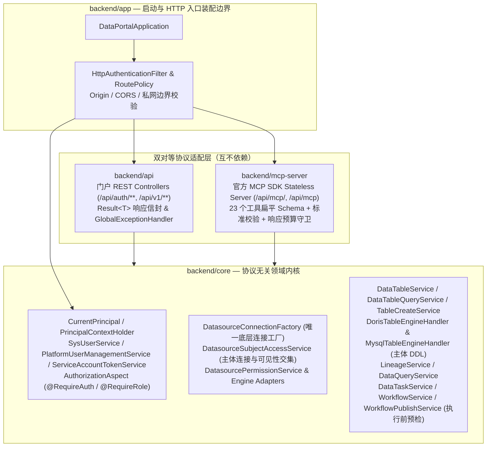

# Backend 终态架构收敛设计：四子模块边界、内置 MCP 与核心链路熵减

- 日期：2026-11-03
- 状态：已实施；Java / Vue / Python、真实 MySQL / Dolphin / HTTP MCP 验证通过。外部引擎及独立 DataAgent 完整问答覆盖边界见[实施报告](../reports/2026-11-03-backend-consolidation-validation.md)。
- 关联计划：`docs/plans/2026-11-03-backend-mcp-auth-consolidation-plan.md`
- 协同清理设计与计划（互不重叠）：
  - `docs/design/2026-11-03-backend-legacy-redundancy-cleanup-design.md`（负责平台 MySQL 表裸 `JdbcTemplate` 收口、Dolphin 双 `ThreadLocal` 消除与 `RestClient` 替换 `spring-boot-starter-webflux`、门户前后端废弃 REST 接口与死代码清理）
  - `docs/plans/2026-11-03-backend-legacy-redundancy-cleanup-plan.md`
- 关联历史设计与评审：
  - `docs/reports/2026-11-03-backend-consolidation-entropy-review.md`
  - `docs/design/2026-05-30-odw-auth-module-design.md`
  - `docs/design/2026-08-17-portal-mcp-streamable-http-design.md`
  - `docs/design/2026-09-10-portal-mcp-schema-inlining-design.md`
  - `docs/design/2026-09-14-dataagent-opendataworks-decoupling-design.md`
  - `docs/design/2026-10-26-dataagent-datasource-identity-design.md`
- 受影响栈：`backend`（重构为 `core`、`api`、`mcp-server`、`app` 四子模块，吸收原 `odw-auth` 并消解 `backend-agent-api`）、`odw-mcp-server`（删除）、`odw-skills/`（核对扁平工具配方与测试）、`deploy/`、`scripts/`、`.github/workflows/`

---

## 1. 背景与熵减准则

随着 DataAgent 迁出至独立仓库 `opendataagent`，本仓库后端存在由历史演进留下的多处**重复状态、平行适配层与隐含回退行为**。本次架构收敛不以“单纯减少类或文件数量”或“批量重命名包前缀”为目标，而是严格遵循以下**四条熵减准则**：

1. **同一事实只有一个权威来源**：
   - 身份上下文只有一套（`CurrentPrincipal` + `PrincipalContextHolder`），消除 `UserContext` 与 `AgentIdentityContext` 双轨；
   - 底层 JDBC 连接创建只有一处（保留既有的 `DatasourceConnectionFactory`），不在上层重复造连接池或凭据袋；
   - 每个 MCP 工具的入参结构只有一份可执行 JSON Schema，不在 Handler 中再手写一套平行的字段校验器。
2. **同一操作只有一条明确主路径**：
   - 外部 Agent 统一通过内置标准 MCP（`/api/mcp/`）直达 `core` 领域服务，彻底删除 Python `odw-mcp-server` → `/api/v1/ai/**` REST Controller → `Agent*Service` → `BackendAgent*Service` 的四层中转跳板。
3. **权限语义严格守恒，消除隐式提权风险**：
   - 人工 DDL 使用当前 USER 映射账号，Agent DDL 始终使用已认证 SERVICE 自身映射账号；可选用户头仅用于只读权限交集，后台同步/采集显式使用系统连接，废除 `ThreadLocal<Boolean> systemAccess` 隐式开关，绝不把人工物理建表/改表升级为系统管理账号执行。
4. **协议与领域边界清晰正交**：
   - `core` 保持协议无关（不含 Servlet Filter、HTTP 路由策略或 REST `Result<T>` 信封）；HTTP 入口认证、Origin/CORS 策略归属 `app` 装配边界，REST 信封归属 `api`，MCP 传输与 Schema 归属 `mcp-server`。

---

## 2. 目标范围与边界

### 2.1 本设计目标

1. **确立四子模块架构（`core` + `api` + `mcp-server` + `app`）与 Java 17 / Spring Boot 3.5.x 基线**
   - 以 `backend/pom.xml` 为唯一 Maven 父工程及 Reactor；保留现有 `com.onedata.portal.*` 包名体系（不做无业务价值的全仓包名机械重命名），将原 `odw-auth` 合入 `backend`，删除顶层 `odw-auth/`、`backend-agent-api/`、`odw-mcp-server/` 与根 `pom.xml`。
2. **删除 `/api/v1/ai/**` REST 接口与 `BackendAgent*Service` 平行适配层**
   - 删除原 `backend-agent-api` 的 7 个 `Agent*Controller`、6 个 `Agent*Service` 接口、6 个 `BackendAgent*Service` 实现类及仅用于跨模块中转的包装 DTO；`mcp-server` 的工具处理器直接调用 `core` 领域服务。
3. **保持全部 23 个 MCP 工具对已认证服务账号可用**
   - 在平台级用户功能权限（RBAC）设计落地前，移除原 `AgentApiAuthInterceptor` 中硬编码拦截 17 个开发/工作流工具的 `403` 门禁，保持 23 个 `odw_*` 工具全部注册且可正常调用；
   - 数据源级原生权限校验（只读查询的双账号 `EXPLAIN + SELECT`、元数据列可见性交集、物理建表使用主体数据库映射账号）以及工作流发布/调度上线时的当前状态预检保持强制执行；删除预览签名令牌，预览作为只读差异查看能力保留。
4. **收敛数据源主体访问、查询执行与物理 DDL 职责边界**
   - 保留 `DatasourceConnectionFactory` 作为唯一底层连接工厂；
   - `DatasourceSubjectAccessService` 专注主体身份解析（修复 `<authSource>:<externalId>` 精确匹配）、成员状态校验、主体连接获取与库/表/列可见性交集，删除 `AgentDatasourceResolution` 上的 10 个 `@JsonIgnore` 明文密码字段；
   - `DataQueryService` 专注只读 SQL 守卫、双账号 `EXPLAIN + SELECT` 协同、JDBC 流式字节预算读取与 `data_query_history` 审计写入；
   - `DorisTableEngineHandler` 吸收原 `DorisConnectionService` 中的 Doris `ALTER TABLE` SQL 拼接方法，且**交互式物理建表/改表/删表强制使用主体连接，后台采集显式使用系统连接**。
5. **服务账号原生写授权与门户角色选择同步**
   - 服务账号可绑定经管理员授权的数据库读写映射，不再在权限中心按 SERVICE 类型硬编码只读角色限制；READONLY 模板仍保持只读。
   - 只读工具仍强制只读连接和 SQL 守卫；物理 DDL 使用 SERVICE 自身映射，绝不借用用户头写权限。同步移除门户角色选择器对 SERVICE 写角色的禁用，并回归原生拒绝/允许场景。
6. **MCP 顶层扁平 `inputSchema` 单一契约与响应体积双层预算**
   - 23 个工具采用顶层扁平、内联（零 `$ref`/`$defs`）的 JSON Schema，移除 FastMCP 遗留的 `{"params": {...}}` 外层包裹；由标准 JSON Schema 校验器统一执行结构校验，并区分 JDBC 行读取预算与 MCP 最终响应（含 `TextContent` + `structuredContent`）预算。

### 2.2 非目标与待办边界（Out of Scope）

- **平台级用户与服务账号功能权限（RBAC）**：本期保持 23 个工具对已认证服务账号开放；数据库操作仍受主体原生权限约束，发布/上线仍执行领域预检。此开放范围是明确的现阶段平台能力，不将数据库权限、预览或差异确认标记当作平台资源授权；平台功能级权限（如限制某用户或某服务账号只能读工作流而不能建表/改任务）记入 `docs/TODO.md`，待后续独立设计功能权限模型后再接入。
- **平台表裸 `JdbcTemplate` 收口、Dolphin 双 `ThreadLocal` 清理与 `RestClient` 替换 WebFlux、门户废弃 REST 接口清理**：统一归口在协同文档 [2026-11-03-backend-legacy-redundancy-cleanup-design.md](2026-11-03-backend-legacy-redundancy-cleanup-design.md) 中，不在本设计重复立项。

---

## 3. 总体架构与方案设计

### 3.1 构建基线与四子模块职责边界

```text
backend/
├── pom.xml          # 父工程 / Reactor，统一管理 Java 17、Spring Boot 3.5.x 与依赖版本
├── core/            # 协议无关领域内核：主体上下文、认证/账号/Token 领域服务、数据源访问与多引擎适配、核心业务 Service 与 Mapper
├── api/             # Web REST 适配层：仅面向浏览器门户前端的 REST Controllers、Result<T> 信封与 GlobalExceptionHandler
├── mcp-server/      # MCP 协议适配层：官方 MCP SDK Stateless Server、23 个工具 Schema、标准 Schema 校验器与同步 Tool Handlers
└── app/             # 启动与 HTTP 装配边界：DataPortalApplication、AuthenticationFilter、路由策略、CORS/Origin 安全配置、application.yml、Flyway
```



#### 3.1.1 子模块依赖与协议隔离约束

| 子模块 | 核心职责 | 允许依赖 | 严格禁止项 |
|---|---|---|---|
| `core` | 主体与安全领域服务、数据源连接工厂与主体访问服务、表/血缘/查询/任务/工作流/治理业务服务、MyBatis Entity & Mapper | Spring Context/TX、MyBatis-Plus、JSqlParser、JWT、BCrypt、JDBC 驱动 | **严禁依赖 `api`、`mcp-server`、`app`；严禁引入 `jakarta.servlet.*`、Spring MVC Controller/Filter、REST `Result<T>` 或 `io.modelcontextprotocol.*`** |
| `api` | 门户前端 REST Controller（`/auth/**`、`/v1/**`）、REST 返回信封 `Result<T>`、`GlobalExceptionHandler` | `core`、`spring-boot-starter-web` | 严禁依赖 `mcp-server` 或 `app` |
| `mcp-server` | 官方 MCP SDK `WebMvcStatelessServerTransport`、23 个工具 Schema 与 JSON Schema 校验器、同步工具 Handler、MCP 响应预算守卫 | `core`、`mcp-core`、`mcp-json-jackson2`、`mcp-spring-webmvc` | 严禁依赖 `api` 或 `app` |
| `app` | `DataPortalApplication`、`HttpAuthenticationFilter`、`AuthenticationRoutePolicy`、CORS/Origin/私网安全配置、`application.yml`、`db/migration` | `core`、`api`、`mcp-server` | 唯一启用 `spring-boot-maven-plugin` `repackage` 的模块 |

> **关于 Reactor 依赖的说明（回应 R8）**：移除不再使用的 `spring-boot-starter-webflux`（及 Netty）后，`mcp-server` 引入的官方 `io.modelcontextprotocol.sdk:mcp-core` 自身依赖 `io.projectreactor:reactor-core`。因此 `mcp-server` 传递包含 `reactor-core` 属于 SDK 正常内部依赖，不排除 `reactor-core`，仅确保业务代码与 `core`/`api` 不引入 WebFlux 响应式栈。

---

### 3.2 统一身份、认证与 HTTP 入口边界（回应 R3、R4、N2、N3）

#### 3.2.1 不可变 `CurrentPrincipal` 与支持嵌套恢复的 `PrincipalContextHolder`（位于 `core`）

1. **`CurrentPrincipal` 结构**：
   - `subjectId`（`Long`，对应 `sys_user.id`）
   - `accountType`（`AccountType.USER` / `AccountType.SERVICE`）
   - `authenticationMethod`（`SESSION` / `SERVICE_TOKEN`）
   - `username`（`String`）
   - `role`（`String`，仅 `USER` 有效）
   - `sessionVersion`（`int`，仅 `USER` 有效）
   - `delegatedUserKey`（`String`，可选，格式 `<authSource>:<identifier>`，仅 `SERVICE` 路由携带 `X-Agent-User-Id` 时写入）
2. **`PrincipalContextHolder` 严格作用域与嵌套语义（回应 R4）**：
   - `runWith(CurrentPrincipal principal, Callable<T>/Supplier<T> action)`：
     - 进入时保存当前线程已有的 `previousPrincipal` 与 `previousScope`；
     - 绑定新的 `principal`；若 `principal` 与 `previousPrincipal` 的 `(subjectId, accountType, delegatedUserKey)` 相同则继承同一请求缓存，否则创建独立缓存；
     - 在 `finally` 块中：若 `previousPrincipal != null` 则精确恢复 `previousPrincipal` 与 `previousScope`；仅当最外层（`previousPrincipal == null`）退出时才执行 `ThreadLocal.remove()`。
   - **缓存键隔离**：请求级可见列缓存键强制由 `(clusterId, subjectId, accountType, Objects.toString(delegatedUserKey, ""))` 复合构成，绝不跨主体或跨委托身份串用。
   - **权限校验语义**：`@RequireRole("admin")` 切面（`AuthorizationAspect`）强制校验 `principal.getAccountType() == USER && "admin".equals(principal.getRole())`；`delegatedUserKey` 是调用方声明的可选用户标识，仅用于只读数据源权限交集；写操作审计主体固定为已认证 SERVICE，不能将该头记为已验证的自然人操作者，绝不将 `SERVICE` 提升为门户管理员。

#### 3.2.2 账号与认证领域服务职责保持单一（回应 R3）

不将所有围绕 `sys_user` 的逻辑塞入单个巨型类，保持三个职责清晰的服务并共享同一套 Mapper 与审计底座：
- **`SysUserService`**：负责用户登录口令校验、失败次数累计与锁定、会话状态校验（`verifySession` 核对 `enabled=1, deleted=0, session_version`）、个人修改密码；
- **`PlatformUserManagementService`**：负责管理员对 `USER` 与 `SERVICE` 账号的列表查询、创建、修改、启停、软删除、重置密码；
- **`ServiceAccountTokenService`**：负责服务账号 `odw_sa_*` Token 的签发（`FOR UPDATE` 行锁、明文仅返回一次）、吊销、SHA-256 摘要认证与 `last_used_at` 更新；
- **唯一状态与审计来源**：三者统一通过 `SysUserMapper` 执行 `session_version` 原子递增与管理员行锁，统一通过 `PlatformUserOperationMapper` 写入 `platform_user_operation` 审计表。

#### 3.2.3 外部用户身份 `<authSource>:<externalId>` 精确解析（回应 N2）

在解析 `delegatedUserKey`（`X-Agent-User-Id`）对应的平台 `SysUser` 时：
- 校验格式必须为 `<source>:<subject>`（两端均非空）；
- 当 `source` 为 `"local"` 时：查询 `WHERE auth_source = 'local' AND username = #{subject} AND deleted = 0`；
- 当 `source` 不为 `"local"` 时：**严格按具体来源查询 `WHERE auth_source = #{source} AND external_id = #{subject} AND deleted = 0`**（彻底修正原代码中 `auth_source != 'local'` 不匹配具体来源前缀的缺陷）；
- 校验目标账号必须处于 `enabled = true` 且 `accountType == USER`（禁止将服务账号作为被委托自然人）。

#### 3.2.4 HTTP 入口认证过滤器与 Origin / CORS / 私网策略统一（位于 `app`，回应 R4、N3）

`HttpAuthenticationFilter` 与 `AuthenticationRoutePolicy` 放置在 `backend/app` 装配层，统一管控两类入口：

| 路由分类 | 匹配路径（相对于 context-path `/api`） | 凭据要求 | Origin / CORS / 网络边界策略 |
|---|---|---|---|
| `PUBLIC` | `/auth/login`, `/auth/logout`, `/v1/health/**`, `/actuator/health`, `/error` | 无需凭据（不再包含 `/v1/ai/**`，也不再将 `/auth/me`、`/auth/password` 放入白名单；彻底移除 `odw.auth.anonymous.*` 匿名管理员回退开关） | 仅允许配置的 `odw.http.allowed-origins` 跨域访问 |
| `USER` | `/auth/me`, `/auth/password`, `/v1/**` | 仅接受 `odw_session` Cookie 或 `Authorization: Bearer <session_jwt>`（显式 `Authorization` 优先，无效 Bearer 直接 401 不回退 Cookie；拒绝 `odw_sa_*`） | 仅对匹配 `odw.http.allowed-origins` 的请求回显 `Access-Control-Allow-Origin` 与 `Allow-Credentials: true`，废除任意 Origin 通配回显 |
| `SERVICE` | `/mcp`, `/mcp/` | 仅接受 `Authorization: Bearer odw_sa_<token>`（拒绝 Cookie 与用户 JWT）；可选读取 `X-Agent-User-Id` 写入 `delegatedUserKey` | 1. 不启用浏览器凭据 CORS；<br>2. 若请求包含 `Origin` 头，必须匹配 `odw.http.allowed-origins` 否则 403 拒绝（弥补 SDK 默认 NOOP validator）；<br>3. 开启 `require-private-network` 时校验客户端地址为私网/回环地址（仅当 `remoteAddr` 属于显式配置的 `trusted-proxies` 时解析 `X-Forwarded-For`：从连接对端开始，自右向左剥离受信代理，取第一个非受信地址；否则忽略转发头并使用 `remoteAddr`。禁止直接取最左值，非法地址链拒绝；受信代理仅配置实际代理地址） |

---

### 3.3 数据源连接、主体权限、查询与物理 DDL 职责分离（回应 R1、R3、R7）

#### 3.3.1 四层职责划分（拒绝大杂烩，保留 `DatasourceConnectionFactory`）

| 组件 | 归属 | 唯一职责 |
|---|---|---|
| `DatasourceConnectionFactory`（保留现有） | `core` | 驱动可用性检查、`ConnectionConfig` 组装、只读会话初始化（`adapter.applyReadOnly`）、连接超时与异常关闭清理 |
| `DatasourceSubjectAccessService` | `core` | 1. 维护“主体/委托用户 → 数据库映射账号”解析与成员/角色状态核验；<br>2. 提供显式语义的连接获取入口（区分**主体连接**与**系统连接**）；<br>3. 计算并按 `(clusterId, subjectId, accountType, delegatedUserKey)` 缓存库/表/列可见性交集；<br>4. 返回不含任何密码字段的 `DatasourceResolutionDto` |
| `DataQueryService` | `core` | 1. `SqlReadOnlyGuard` 单语句只读语法校验与 `LIMIT` 改写；<br>2. Web 多语句交互查询（`executeQuery`）与受限单语句只读查询（`executeReadOnlyQuery`，含双账号 `EXPLAIN + SELECT`）；<br>3. JDBC `ResultSet` 读取期按完整行执行字节预算守卫，保留所返回单元格的原值；<br>4. 统一写入 `data_query_history` 审计记录 |
| `TableEngineHandler`（`DorisTableEngineHandler` / `MysqlTableEngineHandler`） | `core` | 生成引擎特定的建表/改表/删表物理 DDL（将原 `DorisConnectionService` 中的 Doris `ALTER TABLE` SQL 拼接方法全部收归 `DorisTableEngineHandler`），并**通过主体读写连接**执行交互式物理 DDL |

#### 3.3.2 严格区分主体连接与系统连接，杜绝人工 DDL 提权（回应 R1 · P1）

彻底删除 `DorisConnectionService` 中的 `ThreadLocal<Boolean> systemAccess` 隐式开关，所有数据库操作按调用性质显式使用以下两类入口，**人工或 Agent 操作在缺失账号映射或原生权限不足时直接报错，永不回退到系统连接**：

| 连接入口方法 | 使用的数据库凭据 | 读写模式 | 允许的调用点（全集） |
|---|---|---|---|
| `openPrincipalConnection(clusterId, db, readOnly)`<br>及封装的 `executeAsPrincipal(clusterId, db, sql)` | - Web `USER`：使用当前登录用户的 `USER` 映射账号；<br>- MCP `SERVICE`：实际执行始终使用已认证 SERVICE 自身映射账号；无写映射或原生无写权限时直接拒绝；<br>- 携带 `delegatedUserKey` 的只读查询增加 `EXPLAIN(USER)` 检查，再以 SERVICE 执行；**建表/改表等写操作不按该头切换账号，也不使用被声明 USER 的凭据** | 按参数 `readOnly` | 1. **表设计器物理建表**（`TableCreateService.create` → `TableEngineHandler.executeCreateTable`）<br>2. **表结构与注释编辑**（`DataTableService.createField` / `updateField` / `deleteField` / `updateTableComment` → `TableEngineHandler`）<br>3. **表软删除、恢复、物理清理**（`DataTableService.softDeleteTable` / `restoreTable` / `purgeTableNow` → `TableEngineHandler`）<br>4. **Data Studio 实时目录树、表数据预览、DDL 查看、字段枚举分布统计**（`DorisClusterController` 目录接口、`DataTableQueryService`）<br>5. **Web SQL 查询与 MCP 只读查询**（`DataQueryService`） |
| `openSystemConnection(clusterId, db)`<br>及封装的 `executeAsSystem(clusterId, db, sql)` | 数据源集群配置的平台管理账号（`doris_cluster.username/password`） | 按场景 | **仅限后台同步与管理运维**：<br>1. 元数据全量/按库/按表同步与稽核（`DorisMetadataSyncService` / `DataTableMetadataSyncService`）<br>2. 管理员配置数据源时的连接测试与采集范围预览（`DorisClusterController.testConnection` / `metadataScope`）<br>3. 表容量/行数统计采集（`DorisConnectionService.getTableStatistics` / `getTableRuntimeStats` / `listTablePartitions`）<br>4. Schema 快照备份与恢复（`SchemaBackupService`）<br>5. 数据新鲜度定时检查、质量巡检与 Doris 访问审计采集（`TableFreshnessService` / `InspectionService` / `DorisTableAccessService`） |

#### 3.3.3 查询结果预算与审计的唯一事实（回应 R7、F4）

1. **core 决定查询结果，返回完整行与原始单元格值**：
   - MCP 只读查询传入 `rowPayloadBudgetBytes = 131072`（128KiB）；Web 查询保持原有行数与返回契约，不因 MCP 限制统一缩短字段。
   - JDBC 读取阶段累计完整行的 JSON UTF-8 序列化字节数；超过预算的当前行不加入结果，停止读取并设置 `hasMore = true, truncatedBySize = true`。若首行即超限，返回 `rows = []` 与明确 `notice`，建议缩小字段或查询范围。
   - 不新增 `maxCellChars`，不在值中追加截断字符串。超大字符/二进制 LOB 通过流读取并计数，达到预算即停止，不先完整装入内存再判断；不同驱动的预缓冲行为在真实引擎验证中检查，不仅凭循环结构承诺内存有界。
   - `DataQueryService` 只构造一次不可变查询结果，按该结果统一写入 `data_query_history` 的行数、截断标记与预览；历史表示数据库查询执行及其受预算约束的结果，不代表下游已收到响应。
2. **MCP 只包装结果，不再次删行或改值**：
   - 所有 `tools/call` 结果均检查 `CallToolResult` 的最终 JSON UTF-8 大小（含文本与 `structuredContent` 双份承载），工具结果预算为 `524288` 字节。128KiB 行预算为双份承载、转义及元数据留出余量；最终检查仍是权威判断。
   - 若结果仍超限，返回固定、简短的 `isError: true` 结果，说明查询/操作可能已经执行、此次结果超出返回限制，建议缩小查询或通过门户查看；不附超长原文，不自动重执行业务操作。元数据、DDL、列表及异常同样适用，不依赖存在 `rows`。
   - `512KiB` 是工具结果预算，不混称为整个 HTTP 响应上限；回归中同时测量 SDK JSON-RPC 外壳后的实际大小，核对当前 DataAgent 接收限制。协议包装失败不会将已经成功的数据库执行历史改写为失败，写操作超限也不能提示其副作用未发生。

---

### 3.4 统一发布预检，删除预览签名令牌（回应 R6、F1、F2）

- `odw_preview_publish` 保留为只读工具，返回当前差异、错误、警告及 `canPublish`，不签发发布凭证。
- `odw_publish_workflow` 直接调用 `WorkflowPublishService.publish`。部署时保留 `handleDeploy` 对当前状态重新构建预览、检查 `canPublish` 和差异确认的逻辑；`confirmDiff` 直接传入现有请求字段，未传为 false，适配层不得自动设为 true。它只表示调用方接受差异，不证明自然人批准。
- `online` / `offline` 保留现有领域状态校验；`odw_workflow_schedule_online` 调用 `WorkflowScheduleService.onlineSchedule`，检查当前工作流已上线且存在调度。Web 与 MCP 共享这些业务规则，不建立 MCP 专用发布规则。
- 删除 `AgentPreviewTokenSupport` 及仅用于签发/校验预览令牌的包装 DTO、字段与测试；不新增 `WorkflowPublishPreviewTokenService`、随机密钥回退、nonce 集合、过期清理任务或新的发布密钥配置。会话 JWT 保持原有密钥校验与缺失时拒绝启动规则。
- 本次不新增一次性执行、跨请求锁定预览或用户审批要求。预览是辅助查看；真正执行时重新校验。不将请求顺序写成安全授权，不宣称防重试或 exactly-once。

---

### 3.5 内置 Streamable HTTP MCP 服务端设计（`backend/mcp-server`）

#### 3.5.1 官方 SDK 传输与上下文传播（回应 R4、R8）

1. **传输端点与无状态模式**：
   - 使用官方 `io.modelcontextprotocol.sdk`（候选 `0.18.5`，Task 0 实测验证）：基于 `WebMvcStatelessServerTransport` 与 `McpServer.sync(transport)` 构建无状态 MCP 服务端；
   - 标准路径为 `/api/mcp/`，并在 `app`/`mcp-server` 路由注册中同时支持 `/api/mcp` 别名（Task 0 在最小工程中实测 `RouterFunction` 同时匹配 `/mcp` 与 `/mcp/` 或 RequestWrapper 转发，确保 POST 不依赖重定向）。
2. **上下文传播**：
   - `HttpAuthenticationFilter` 认证 `Bearer odw_sa_*` 后，将 `CurrentPrincipal` 写入 `request.setAttribute(...)`；
   - `McpTransportContextExtractor` 从 `HttpServletRequest` 提取 `CurrentPrincipal` 放入 `McpTransportContext`；
   - 每个同步工具处理器通过 `PrincipalContextHolder.runWith(principal, () -> ...)` 绑定并在 `finally` 中精确恢复/清理。

#### 3.5.2 单一权威 Schema 校验与 23 个可用工具映射（回应 R2、R5）

1. **单一 Schema 权威来源（不在 Handler 重复手写校验器）**：
   - 每个工具在 `McpToolSchemaRegistry` 中定义唯一一份顶层扁平、完全内联（零 `$ref`/`$defs`）的 JSON Schema；
   - 工具调用入口统一使用标准 JSON Schema 校验器（采用 `networknt/json-schema-validator`，具体版本由 Task 0 锁定，不自建校验器）对原始 `arguments` Map 执行结构、类型、必填、枚举、`minItems`/`minimum`/`maximum` 及 `additionalProperties: false` 校验；
   - 校验通过后剥离可选顶层展示字段 `description`，工具入参与现有领域请求采用同名 camelCase，校验后可通过默认 `ObjectMapper.convertValue` 绑定现有强类型请求对象，不新增字段改名层。适配层仅提取方法参数、解开业务包装结构并调用领域服务，不重复结构校验，也不修改门户全局 Jackson 配置。
2. **复合对象字段契约与血缘三态规则（回应 R5）**：
   - 所有工具顶层 Schema 均设置 `"additionalProperties": false`（因此传入旧版 `{"params": {...}}` 会被 Schema 校验器直接拒绝）；
   - 对于 `odw_create_task` / `odw_update_task` 的 `task` 对象、`odw_create_workflow` / `odw_update_workflow` 的 `workflow` 对象、`odw_upsert_schedule` 的 `schedule` 对象，根据 `DataTask`、`WorkflowDefinitionRequest`、`WorkflowScheduleRequest` 的实际支持字段显式列出 `properties` 并设置 `"additionalProperties": false`（其中 `schedule` 的 `properties` 明确不包含 `enabled`，从 Schema 源头拦截通过 `odw_upsert_schedule` 启停调度）；
   - 对于 `odw_update_task`：
     - `inputTableIds`：Schema 为 `{"type": "array", "items": {"type": "integer"}}`（允许 `[]`）；当 `arguments.containsKey("inputTableIds")` 为 `false` 时传 `null`（保留原输入血缘），为 `true` 且传 `[]` 时清空输入血缘；
     - `outputTableIds`：Schema 显式声明 `"minItems": 1`（`{"type": "array", "items": {"type": "integer"}, "minItems": 1}`）；当省略时传 `null`（保留原输出血缘），当显式传入时禁止为空数组，与业务契约完全一致。

**统一命名与绑定约束（回应 F5）**：

- 23 个工具的固定入参字段，无论顶层还是嵌套对象，统一沿用现有 Java/Web 请求的 camelCase，例如 `dbName`、`dorisClusterId`、`workflowId`、`inputTableIds`、`confirmDiff`，不为同一字段维护两种名字。`database` 等已有单词字段保持语义与名称，不借本次统一命名改变业务含义。
- 工具名称继续使用既有 `odw_*`；数据库表列、SQL 原文以及用户自定义 Map 的键不属于参数命名转换范围，不递归改写。
- 不新增 snake_case 别名、兼容请求 DTO、命名策略或逐字段改名表。旧 snake_case 参数按未知字段拒绝，Schema、Skill 示例与测试在同一次交付中切换；客户端刷新工具缓存。
- 对已同名同结构的现有请求对象直接绑定；`workflowId`、`taskId` 提取为方法参数，`task`、`workflow`、`schedule` 按现有服务签名解包。这些结构适配保留，但不再复制一套仅为改名而存在的请求类型。
- 默认值在完成 Schema 校验后由适配方法一次性赋值，不依赖校验器补默认。非 nullable 字段显式 null 直接拒绝，血缘省略与空数组仍遵守上述规则。operator/审计身份来自 `CurrentPrincipal`，不采信入参覆盖。


3. **23 个工具完整清单与领域服务调用映射（全部对已认证服务账号开放可用）**：

| 分类 | 工具名称 | `readOnlyHint` | `destructiveHint` | `idempotentHint` | 顶层扁平入参字段（均含可选 `description`） | 直接调用的 `core` 领域服务方法 |
|---|---|---|---|---|---|---|
| 只读探查与问数 | `odw_search_tables` | `true` | `false` | `true` | `database?`, `table?`, `keyword?`, `tableLimit?=12` | `DataTableQueryService.inspectTables(...)` |
| 只读探查与问数 | `odw_get_lineage` | `true` | `false` | `true` | `table?`, `dbName?`, `tableId?`, `depth?`（Schema `anyOf` 约束 `table` 与 `tableId` 至少其一） | `LineageService.inspectLineage(...)` |
| 只读探查与问数 | `odw_resolve_datasource` | `true` | `false` | `true` | `database`, `preferredEngine?` | `DatasourceSubjectAccessService.resolveDatabaseDatasource(...)` |
| 只读探查与问数 | `odw_export_metadata` | `true` | `false` | `true` | `kind` (`tables`/`lineage`/`datasource`), `database?` | `DataTableQueryService.exportMetadata(...)` |
| 只读探查与问数 | `odw_get_table_ddl` | `true` | `false` | `true` | `database?`, `table?`, `tableId?`（Schema `anyOf` 约束 `tableId` 或 `database+table`） | `DataTableQueryService.inspectTableDdl(...)` |
| 只读探查与问数 | `odw_query_readonly` | `true` | `false` | `true` | `database`, `sql`, `preferredEngine?`, `limit?=1000`, `timeoutSeconds?=30` | `DataQueryService.executeReadOnlyQuery(...)`（含 128KiB 行预算 + 512KiB 工具结果预算） |
| 只读探查与预览 | `odw_analyze_sql` | `true` | `false` | `true` | `sql`, `database?`, `clusterId?` | `DataQueryService.analyzeQuery(...)` |
| 只读探查与预览 | `odw_preview_create_table` | `true` | `false` | `true` | `dbName`, `columns`, `layer?`, `businessDomain?`, `dataDomain?`, `customIdentifier?`, `statisticsCycle?`, `updateType?`, `tableComment?`, `owner?`, `tableModel?`, `bucketNum?`, `replicaNum?`, `partitionColumn?`, `distributionColumns?`, `keyColumns?`, `dorisClusterId?`, `syncToDoris?`, `dorisDdl?` | `TableCreateService.preview(...)` |
| 只读探查与预览 | `odw_get_task` | `true` | `false` | `true` | `taskId` | `DataTaskService.getTaskOrThrow(...)` |
| 只读探查与预览 | `odw_list_tasks` | `true` | `false` | `true` | `keyword?`, `status?`, `limit?=50` | `DataTaskService.listTasks(...)` |
| 只读探查与预览 | `odw_get_workflow` | `true` | `false` | `true` | `workflowId` | `WorkflowService.getDetail(...)` |
| 只读探查与预览 | `odw_list_workflows` | `true` | `false` | `true` | `keyword?`, `status?`, `limit?=50` | `WorkflowService.list(...)` |
| 只读探查与预览 | `odw_preview_publish` | `true` | `false` | `true` | `workflowId` | `WorkflowPublishService.previewPublish(...)`（只读差异与预检） |
| 草稿级写工具 | `odw_update_table_metadata` | `false` | `false` | `false` | `tableId?`, `database?`, `table?`, `tableComment?`, `attributes?`, `fields?`, `freshness?` | `DataTableService.completeMetadata(...)`（若同步物理注释则走主体连接） |
| 草稿级写工具 | `odw_create_task` | `false` | `false` | `false` | `task`, `inputTableIds`, `outputTableIds` (`minItems: 1`) | `DataTaskService.createFromDefinition(...)` |
| 草稿级写工具 | `odw_update_task` | `false` | `false` | `false` | `taskId`, `task`, `inputTableIds?`, `outputTableIds?` (`minItems: 1`) | `DataTaskService.updateFromDefinition(...)` |
| 草稿级写工具 | `odw_create_workflow` | `false` | `false` | `false` | `workflow` | `WorkflowService.createWorkflow(...)` |
| 草稿级写工具 | `odw_update_workflow` | `false` | `false` | `false` | `workflowId`, `workflow` | `WorkflowService.updateWorkflow(...)` |
| 草稿级写工具 | `odw_upsert_schedule` | `false` | `false` | `false` | `workflowId`, `schedule`（Schema 排除 `enabled`） | `WorkflowScheduleService.upsertSchedule(...)` |
| 草稿级写工具 | `odw_workflow_schedule_offline` | `false` | `false` | `false` | `workflowId` | `WorkflowScheduleService.offlineSchedule(...)` |
| 高危写工具 | `odw_create_table` | `false` | `true` | `false` | 同 `odw_preview_create_table`（`dorisClusterId` 必填） | `TableCreateService.create(...)`（物理建表强制走主体连接 `openPrincipalConnection`） |
| 高危写工具 | `odw_publish_workflow` | `false` | `true` | `false` | `workflowId`, `operation` (`deploy`/`online`/`offline`), `confirmDiff?=false`（deploy 的差异确认） | `WorkflowPublishService.publish(...)`（执行时重新校验当前状态） |
| 高危写工具 | `odw_workflow_schedule_online` | `false` | `true` | `false` | `workflowId` | `WorkflowScheduleService.onlineSchedule(...)`（校验当前工作流与调度状态） |

---

## 4. 关键权衡与评审回应汇总（Tradeoffs）

| 决策点 | 修订后方案 | 放弃方案 | 理由（对应熵减评审项） |
|---|---|---|---|
| 物理建表/改表（`TableEngineHandler`）的执行凭据 | **USER 使用自身映射，SERVICE 始终使用自身映射；用户头不切换写账号（`openPrincipalConnection`）**；仅后台同步/统计采集使用系统连接 | 使用数据源系统管理凭据（`openSystemConnection`）执行物理 DDL | **回应 R1（P1）**：避免无数据库原生 DDL 权限的用户通过门户或 MCP 借用系统管理账号越权建表/改表 |
| 23 个 MCP 工具的开放范围 | **保留全部 23 个工具对已认证服务账号可用**；数据源级原生权限与执行前业务预检照常强制校验；平台级功能 RBAC 记入 `TODO.md` | 拦截 17 个工具恒定返回 403，或直接删减只剩 6 个工具 | **回应 R2 + 用户明确决策**：这 17 个开发/工作流工具此前已实测可用，在设计平台功能权限前保持可用，既避免迁移死代码，也解决问数助手查询工作流被拒的问题 |
| 数据源连接与查询职责划分 | **保留 `DatasourceConnectionFactory`**；拆分为 `DatasourceSubjectAccessService`（主体连接与可见性）+ `DataQueryService`（只读守卫、流式读取、审计）+ `TableEngineHandler`（引擎 DDL） | 把所有连接、查询、缓存、DDL 塞进单一巨型 `DatasourceAccessService` | **回应 R3**：复用已有连接工厂底座，按“连接选择 / 查询执行 / 引擎方言”正交划分职责 |
| 四模块协议边界与包名 | `core` 彻底剥离 Servlet Filter、HTTP 路由与 `Result<T>`（分别归入 `app` 与 `api`）；**保留 `com.onedata.portal.*` 包名**，不做全仓机械改包 | 将 Filter/`Result<T>` 放 `core`，并把全仓包名改为 `odw.*` | **回应 R4**：确保 `core` 真正协议无关，同时消除数百个文件机械重命名带来的无价值变更 |
| Schema 与统一命名 | 单一 Schema + 标准校验器；参数与现有 Java/Web 请求统一 camelCase，同名对象直接绑定，仅保留结构适配 | 两套命名、逐字段改名表及别名兼容；重复结构校验 | 回应 R5、F5：消除命名差异产生的长期映射维护成本 |
| 发布与调度上线 | 预览只读，执行时走现有领域预检；不签发预览令牌 | 随机密钥回退、签名预览、内存 nonce 一次性消费 | 回应 R6、F1、F2：删除无独立业务必要性的状态，避免把预览误当审批或幂等 |
| MCP 查询结果预算 | core 按完整行限额并审计；MCP 包装后只校验体积，超限返回简短错误 | 改写单元格原值；core 审计后 MCP 再次删行 | 回应 R7、F4：查询结果与审计只有一个事实来源，交付失败不等同于执行失败 |


## PR评审后契约修正（2026-11-04）

针对用户粘贴的19a02dcf评审，先锁定本节契约后修复；影响Java core／api／mcp-server／app、Vue权限页、Nginx及部署／Skill说明，不新增数据库迁移。

- HTTP入口在分类前拒绝矩阵参数、反斜线、重复斜线和点路径段（含编码形式），避免Servlet原始URI与WebMVC匹配语义分歧。门户Nginx默认拒绝/api/mcp及其子路径，外部MCP使用独立受限后端入口；不根据桥接私网地址判断门户公网来源。TLS在前置代理终止时，明确要求ODW_HTTP_ALLOWED_ORIGINS填写门户HTTPS来源，不引入任意Forwarded头信任或另一套隐式Scheme推断。
- 血缘每个非空端点必须可见，至少有一个端点；保留合法input／output半边，非空ID对应缺失或隐藏表仍拒绝。导出统一超过5000行明确失败；现有表导出实际是静默截断、没有truncated标记，不沿用该行为或更改现有列表响应形状。
- 无必填参数的MCP工具允许省略arguments，归一为空对象后仍走同一严格Schema；有必填参数仍拒绝。
- 权限写入失败也刷新当前源成员与操作记录，保留原始失败提示；旧源晚到响应不得污染新源。APPLYING显示执行中，不能显示正常。
- 既有成员原生写入前，将旧角色与目标角色的并集记录为受保护意图并标记APPLYING；成功只保留目标集合，明确未变更的FAILED可恢复旧集合，PARTIAL／UNKNOWN保留并集及ERROR，防止数据库已授新角色时平台允许删除。恢复失败不能把旧APPLYING还原成执行中。新托管账号延续V58加密映射与失败恢复。
- 成员数据库连接或激活失败须提示检查成员账号权限，不归咎于授权管理连接；仅管理SQL失败使用管理连接权限指引。操作状态和SQLState保持。
- 委托只读查询审计保存已解析USER的sys_user.id、实际EXPLAIN账号与SERVICE执行账号。数据源解析同样校验可选委托人的有效身份与映射，不返回未获委托许可的摘要。
- owner是业务归属字段，显式值保留；新建省略时才采用调用者默认值，更新省略时保留旧owner，不与认证审计操作人混用。
- CREATE USER／LOGIN ROLE局部Statement设置20秒超时，超时继续UNKNOWN及密码脱敏语义。平台列标签归一支持大写snake_case，并保留已归一camelCase键。清理Skill／Schema／部署只读与预览Token残留。

验证包含针对每项的定向回归、完整Java／Vue及Python检查，真实HTTP矩阵路径／空arguments／委托审计与真实MySQL部分授权失败恢复；Nginx入口通过配置契约及可用运行环境核验。本机缺失的额外部署拓扑覆盖如实记录于报告及TODO。
